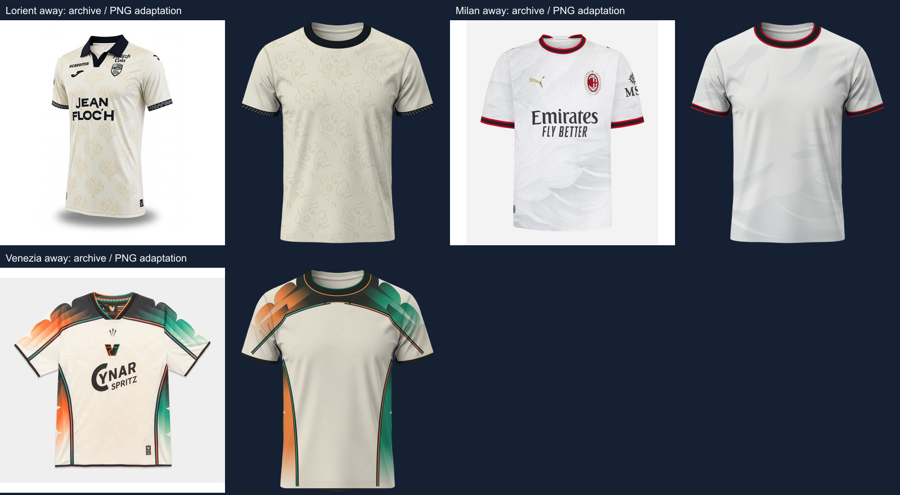

# Tier 1 ornamental Away shirts — 24 September 2026

Three source-backed drafts received separate revisions. **Milan Away r004/p004** and **Venezia Away r003/p003** are now available. **Lorient Away r003/p003** remains a draft. Earlier revisions and the original 8000 × 5000 PNG are preserved.

| Variant | Outcome | Artwork and review |
| --- | --- | --- |
| Milan Away | Ready | Individually mapped pale overlapping facets and lower cascading lobes, with sleeve continuation and red/black/red trim. Fine tonal contours are simplified. |
| Venezia Away | Ready | Curved orange/green shoulder panels, overlapping faded ribbons, narrow seams, tapered side panels and faint source-derived body print. Shoulder yoke joins beneath the existing round collar. Source perspective and fine print are simplified. |
| Lorient Away | Draft | Fine connected paisley loops replace a fragmented threshold mask. Scale and stagger are improved, but internal curls and cuff scrollwork still differ from the source. |

Sources were read independently and confirm 26-27 Away: [Milan](https://www.footballkitarchive.com/ac-milan-2026-27-away-kit-444078/), [Venezia](https://www.footballkitarchive.com/venezia-fc-2026-27-away-kit-508159/), [Lorient](https://www.footballkitarchive.com/fc-lorient-2026-27-away-kit-494913/). Equipment facts remain in local per-team JSON. Estimated colors are not official HEX values. Branding is omitted; no additional V-neck, polo collar or placket is drawn. These are adaptations to the common base, not pixel-identical garment reproductions or human-approved artwork.



## Coverage

- Mandatory: **233 ready, 16 drafts, 27 researching** across 138 teams / 276 slots.
- Global: **251 ready, 24 drafts, 1,195 researching** across 735 teams / 1,470 slots.
- References unchanged: 249 exact-season mandatory references; 317 total archive references; 237 archive-reviewed adaptations.
- The 27 reference gaps remain Real Sociedad Home/Away, Petrolul Away and 24 Finnish slots with calendar-year 2026 evidence only. This batch does not claim to resolve those gaps.

## Reproduce and continue

Scope, fixed predecessor paths, individual decisions, page rechecks and trace provenance are in `data/research/tier1-ornaments-2026-09-24-{scope,review,source-checks,traces}.json`. Lorient's failed threshold diagnostic is explicitly marked unused. Its final drawing study uses manually reconstructed curves. Venezia's branding-free body crop has a saved SHA-256 and trace parameters.

```sh
node scripts/research/fka-ornaments-2026-09-24.mjs --reviewed
node scripts/research/fka-batch-review.mjs tier1-ornaments-2026-09-24
node scripts/research/fka-import.mjs
npm run catalog:build
```

Reviewed revisions are immutable; subsequent corrections require a new revision. No per-kit SVG archive is generated. See [validation](VALIDATION.md) for final test/build results.
