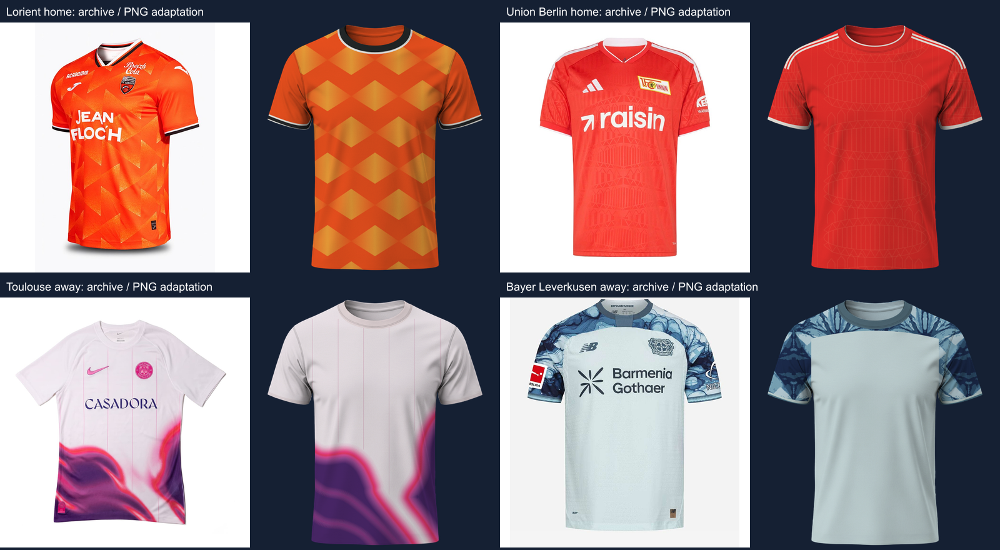

# Tier 1 refinement — 24 September 2026

Four existing 2026/27 drafts received separate r003/p003 revisions. Two are now selectable: **Union Berlin Home** and **Toulouse Away**. The other two remain drafts. No earlier revision, original PNG or pulled application behavior was overwritten.

| Variant | Outcome | Drawing change / remaining gap |
| --- | --- | --- |
| Union Berlin Home | Ready | Connected curved architectural rows, vertical mullions, pointed openings and triangular trusses replace broken threshold lines. Width and contrast corrected after comparison. Fine spacing is an adaptation to the common base. |
| Toulouse Away | Ready | Curved pink/red/magenta transitions around asymmetric purple fields replace hard gradient edges. Interior magenta waves and pink pinlines retained. Fine printed grain is simplified. |
| Lorient Home | Draft | Crossing quadrilateral replaced by ordered wedges; the current diamond-like rows still differ in stagger, slope and granular fade. |
| Bayer Leverkusen Away | Draft | Four source-derived blue fills restore mineral cells and veins. Reflected fragments still make symmetric repeats unlike the full source composition; cuff detail also needs refinement. |

All four archive detail pages were read again and independently confirmed season and variant. Source colors are estimates, not official HEX values. Source garments' collar construction is deliberately adapted to the existing round PNG ring; logos, crests, sponsors and lettering are omitted.



## Coverage after this batch

- Global: 249 ready, 26 drafts, 1,195 researching; 735 teams / 1,470 slots unchanged.
- Mandatory workbook: 231 ready, 18 drafts, 27 researching; 138 teams / 276 slots unchanged.
- Exact-season mandatory references: 249. All archive references: 317. Archive-reviewed adaptations: 235.
- Eighteen of the previous 20 mandatory artwork gaps remain; the full catalog is not complete.

The Real Sociedad Home/Away detail links still returned 404 when followed from the current La Liga listing. Petrolul's listing and exact-season search still yielded no independent Away entry. The existing 24 Finnish calendar-year 2026 references remain context only. Oțelul's exact Away search result is accessible, but its prose/older URL still says Third; its draft is retained while the ambiguous source and fine print remain unresolved.

## Resume and reproduce

Fixed predecessor paths, review decisions, source rechecks and vector trace parameters are saved separately in `data/research/tier1-refinement-2026-09-24-{scope,review,source-checks,traces}.json`. Each new result points to its own immutable kit/layout revision. Equipment facts remain local in the per-team JSON and in deployed kit details.

```sh
node scripts/research/fka-refinement-2026-09-24.mjs --reviewed
node scripts/research/fka-batch-review.mjs tier1-refinement-2026-09-24
node scripts/research/fka-import.mjs
npm run catalog:build
```

After promotion, use `--reviewed` when reproducing this batch: the saver refuses to overwrite a reviewed revision with a draft. Future corrections require another revision. The removed per-kit SVG archive is not generated.

Validation: source-data verification, all 51 Node tests, all 25 Edge tests and the final production build pass. A preview readiness race discovered during screenshot inspection was fixed: ready now identifies the configuration whose pixels finished painting. Browser proof is saved as `studio-union-berlin.png` and `studio-toulouse.png` in the batch artifact directory. The original 8K PNG hash and all previously ready config hashes pass unchanged.
